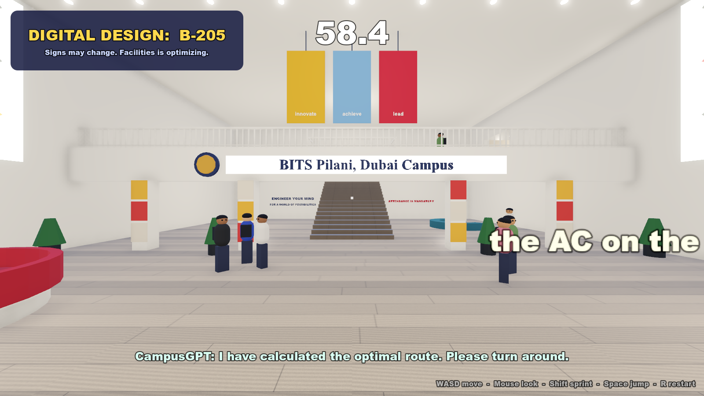
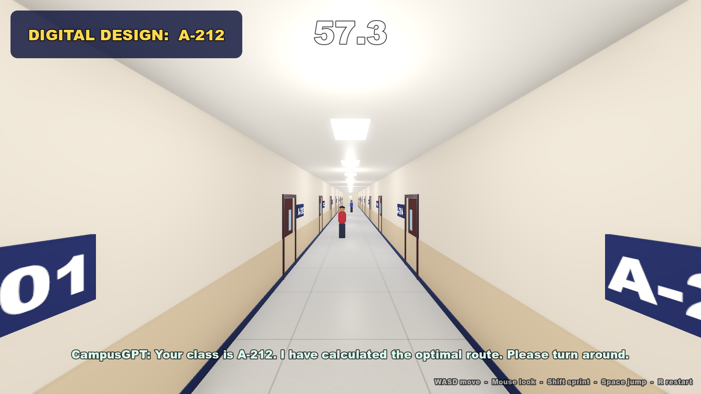
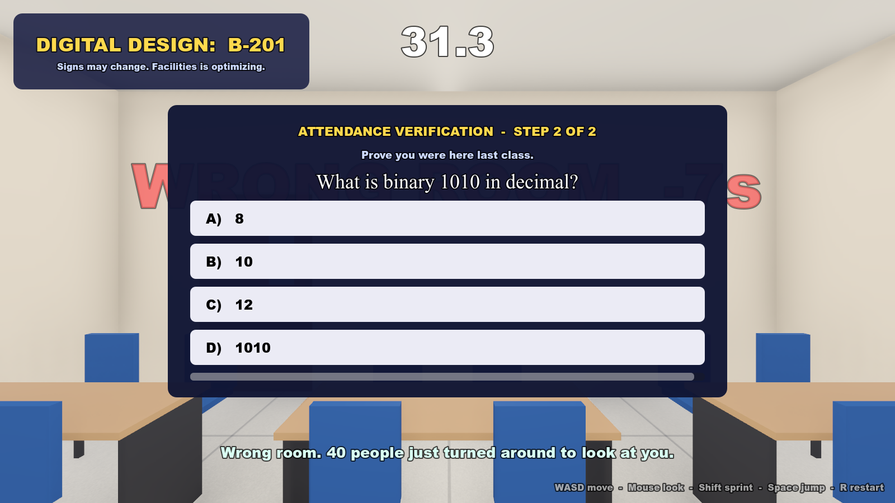
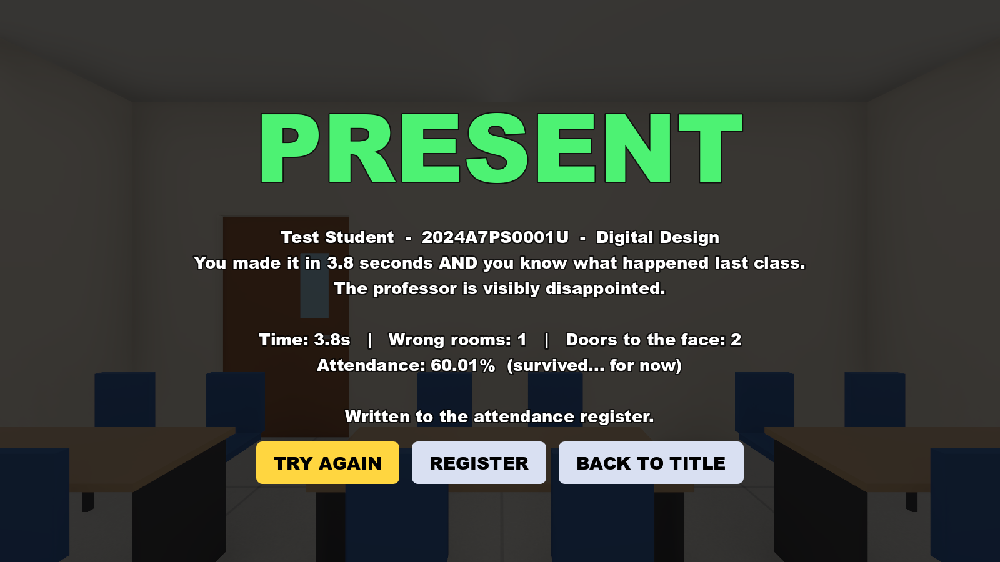

# Attendance Speedrun 🏃‍♂️💨

*Made for ACM x MTC **What The Hack?! 2.0**. Theme: **The Ultimate Inconvenience***

Taking attendance got too easy. Roll call → paper sheets → QR codes → facial recognition.
So we made it inconvenient again.

You're late. The professor won't mark you present until you go back to the **main entrance**, reach your classroom in **60 seconds**, and answer a question about **what happened last class**.
Get it right: **PRESENT**. Get it wrong (or run out of time): **ABSENT**.

All of this happens in a 3D recreation of the **BITS Pilani Dubai Campus** academic block.

## What makes it inconvenient
- Every classroom looks **exactly the same**
- Room numbers **shuffle** while you run
- Wrong room? **-7 seconds**, and you get thrown back out
- Some doors **slam open in your face** and launch you across the corridor
- The quiz has a 10-second timer, and the answers are… questionable

## How to run it
You need the free **Godot game engine**, version **4.6 or newer** (the standard build; the .NET version isn't needed). It runs on Windows, macOS and Linux.

1. **Get the game files**
   - Click the green **Code** button at the top of this page → **Download ZIP**, then unzip it
   - or clone it: `git clone https://github.com/siddharth-vegesna/attendance-speedrun.git`
2. **Install Godot**
   - Download it from [godotengine.org/download](https://godotengine.org/download)
   - No installer: just unzip it and open the Godot app (on macOS, drag it to Applications first)
3. **Open the project**
   - In Godot's Project Manager, click **Import**
   - Browse to the `game` folder inside the downloaded files and select **`project.godot`**
   - Click **Import & Edit**
   - The first time it opens, Godot imports the 3D model, textures and sounds; this takes a few seconds
4. **Play**
   - Press the **▶ Play** button in the top-right corner (or **F5**, **Cmd+B** on macOS)
   - The game opens in its own window

**Once you're in the game:**
- On the title screen, click **MARK MY ATTENDANCE** (or **skip story** to jump straight to the run)
- Press **Space** (or click) to move through the cutscene, or hit **SKIP >>**
- Click inside the game window to lock the mouse, so you can look around
- When the countdown hits GO, find your classroom number on the screen and **run**

| Key | Action |
|---|---|
| WASD / Arrows | Move |
| Mouse | Look around |
| Shift | Sprint |
| Space | Jump / advance dialogue |
| R | Restart |
| Esc | Free the mouse |

## How it's built
- **Blender**: the campus is generated by a Python script (`blender/build_campus.py`) from real photos of the building, then exported to `game/assets/campus.glb`
- **Godot 4**: gameplay, cutscene, quiz and UI (`game/scripts/`)
- Want to change the jokes, questions or timer? It's all in `game/scripts/data.gd`

## Screenshots
| | |
|---|---|
|  |  |
|  |  |
